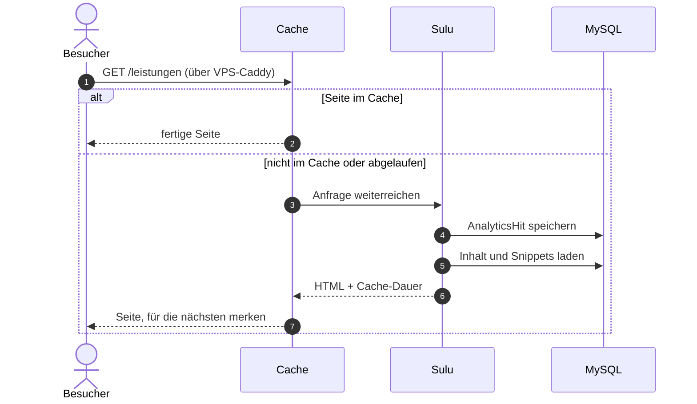
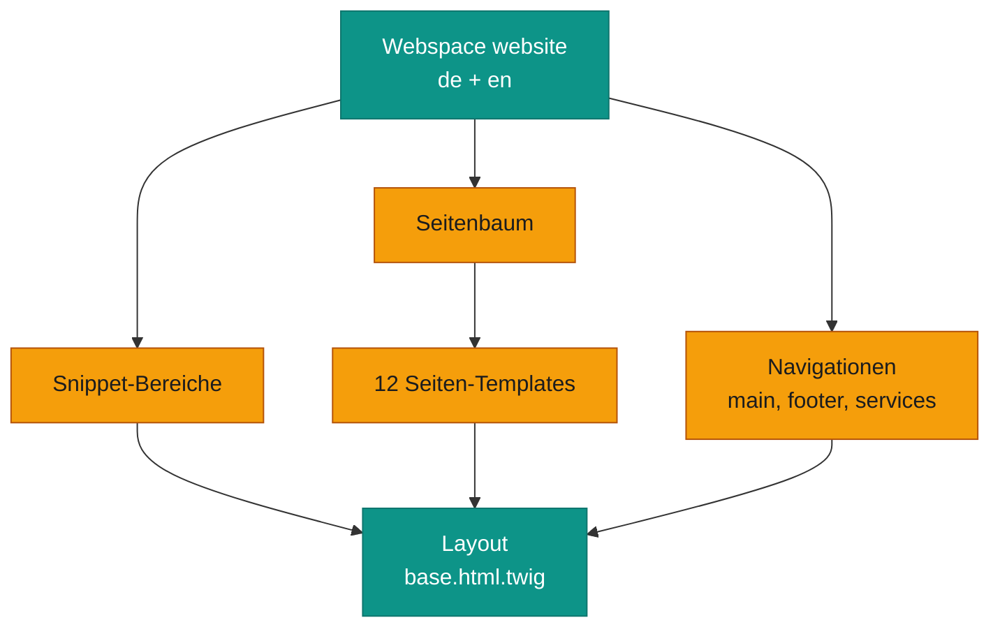
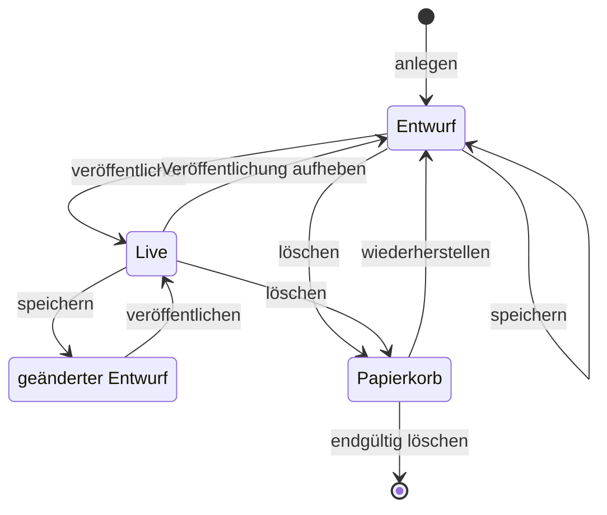
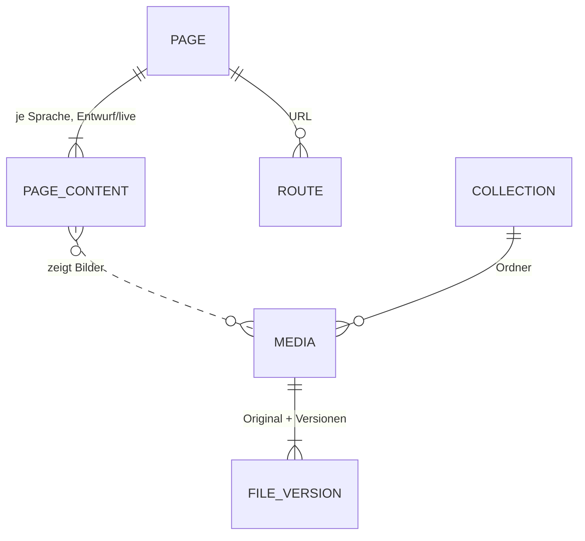
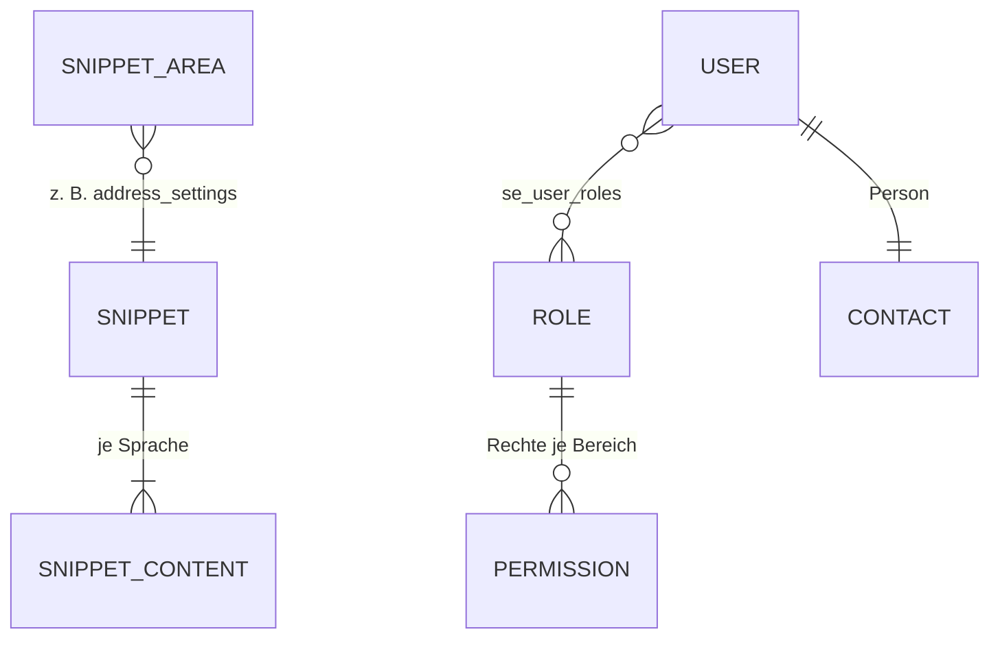

# Aufbau

oralcare ist eine fast unveränderte Sulu-3-Installation. Eigenes steckt an drei Stellen:

- **Templates** (`config/templates/`, `templates/`): Seitentypen, Snippets und das Layout mit Tailwind.
- **Analytics** (`src/`): ein Listener zählt Seitenaufrufe, der Admin zeigt sie als Listen.
- **QR-Landingpage**: eine Seite, die sofort weiterleitet, auf Wunsch direkt in die Terminbuchung.

## Ein Seitenaufruf

*Die Anfrage kommt per HTTPS beim Caddy auf dem VPS an und geht als HTTP über WireGuard weiter, mit
`X-Forwarded-Proto: https`. Vor der Website hängt Sulus HTTP-Cache (Symfony HttpCache, abgelegt in `var/share`). Er hält die meisten Seiten
einen Tag, Impressum, Datenschutz und Standardseiten sieben Tage. Beim Veröffentlichen im Admin leert Sulu die
betroffenen Einträge selbst.*

!!! warning "Der Cache merkt sich http oder https"
    Der Cache unterscheidet nicht zwischen `http://` und `https://`. Wer eine Seite zuerst abruft, legt Canonical-
    und hreflang-Links für alle fest. Deshalb fragt der Container-Healthcheck `/admin/` ab und nicht die Startseite,
    und `TRUSTED_PROXIES` muss auf den VPS zeigen. Sonst sieht Sulu nur `http` (siehe [Wenn's hakt](probleme.md)).

## Admin-Login

<ol>
<li data-title="Admin öffnen" data-where="Browser" data-icon="browser" data-label="/admin">

Die Praxis öffnet <code>/admin</code>. Die Oberfläche (React) ist öffentlich, Daten gibt es erst nach dem Login.

</li>
<li data-title="Passwort" data-where="Sulu" data-icon="key" data-label="JSON-Login">

Benutzername und Passwort gehen per JSON an Sulu. Benutzer und Rollen liegen in der Datenbank (<code>se_users</code>, <code>se_roles</code>).

</li>
<li data-title="Zweiter Faktor" data-where="Sulu" data-icon="shield" data-label="optional">

Ist für das Konto ein zweiter Faktor eingerichtet, fragt Sulu einen Code ab. „Vertrauenswürdige Geräte“ merken sich das per Cookie, das mit <code>APP_SECRET</code> signiert ist.

</li>
<li data-title="Arbeiten" data-where="Admin" data-icon="user">

Seiten, Snippets, Medien und – mit dem passenden Recht – Analytics. Was jemand darf, legen Sulu-Rollen fest.

</li>
</ol>

*Ein neues `APP_SECRET` meldet alle ab und macht die vertrauenswürdigen Geräte ungültig. Deshalb wurde beim Umzug
der bisherige Wert übernommen.*

## QR-Code → Termin

<ol>
<li data-title="Scannen" data-where="Handy" data-icon="phone" data-label="Seiten-URL">

Der QR-Code (z. B. auf einem Flyer) zeigt auf eine Sulu-Seite mit dem Template <em>QR Landing Page</em>.

</li>
<li data-title="Weiterleiten" data-where="Sulu" data-icon="gear" data-label="?booking=1">

Die Seite wird nie gecacht und leitet sofort weiter: im Modus <em>Weiterleitung</em> einfach zur Ziel-URL, im Modus <em>Booking</em> mit angehängtem <code>?booking=1</code>.

</li>
<li data-title="Kontaktseite" data-where="Browser" data-icon="browser" data-label="Widget">

Steht <code>booking=1</code> in der Adresse, öffnet die Kontaktseite automatisch das Dr.-Flex-Fenster.

</li>
<li data-title="Termin" data-where="Dr. Flex" data-icon="cloud">

Die Buchung selbst läuft komplett bei Dr. Flex. oralcare speichert davon nichts.

</li>
</ol>

*Das Buchungsfenster öffnet sich nur, wenn die Ziel-URL die Kontaktseite ist und im Snippet „Allgemeine
Einstellungen“ eine Dr.-Flex-Praxis-ID steht. Ohne ID verweisen die Buchen-Knöpfe auf die Kontaktseite.*

## Inhaltsmodell

*Jede Seite hat ein Template, das ihre Felder festlegt. Was auf allen Seiten gleich ist (Logo, Adresse, Kopf, Fuß,
Social Media, Dr.-Flex-ID), steht einmal in Snippets und wird im Layout geladen.*

| Template | Wofür | Cache |
|---|---|---|
| `homepage` | Startseite | 1 Tag |
| `praxis` | Praxis mit Bildergalerie | 1 Tag |
| `team`, `team_member` | Teamübersicht und Einzelperson | 1 Tag |
| `services`, `service_detail` | Leistungen und einzelne Leistung | 1 Tag |
| `contact` | Kontakt, Karte, Öffnungszeiten, Buchung | 1 Tag |
| `education` | Ratgeber-/Wissensseite | 1 Tag |
| `default`, `imprint`, `privacy` | freie Seite, Impressum, Datenschutz | 7 Tage |
| `qr_landing` | Weiterleitung für QR-Codes | nie |

Snippets: `common_settings` (Firmenname, Logo, Online-Buchung, Dr.-Flex-ID), `address_settings` (Adresse, Telefon,
E-Mail, Öffnungszeiten, Kartenlink), `header_settings`, `footer_settings`, `social_media`, `default`.

## Lebenszyklus einer Seite

*Sulu-Standard: Speichern ändert nur den Entwurf, Besucher sehen ihn nicht. Erst „Veröffentlichen“ geht live und
leert den Seiten-Cache. Inhalte liegen dafür je Sprache in zwei Fassungen (Entwurf und live) in der Datenbank.*

## Analytics

Ein eigener Listener (`src/EventListener/AnalyticsListener.php`) schreibt bei jedem Website-Aufruf eine Zeile in
`app_analytics_hit`. `/admin`, Profiler-Routen und statische Dateien (Bilder, CSS, JS, `/media/`, `/uploads/`)
zählt er nicht.

| Feld | Herkunft |
|---|---|
| URL, User-Agent, Referer | aus der Anfrage |
| Herkunft | `utm_source` aus der URL, sonst der Host des Referers |
| Land | aus der Browsersprache (z. B. `de-DE` → `DE`). Der Cloudflare-Header wird zwar gelesen, kommt hier aber nie an |
| Zeitpunkt | beim Speichern |

IP-Adressen speichert er nicht. Im Admin erscheint der Menüpunkt **Analytics** mit *Logs*, *Top URLs*,
*Top Herkunft*, *Top Länder* und *Traffic nach Tagen* (letzte 30 Tage). Sehen darf ihn nur, wer in seiner Rolle
das Recht `sulu.modules.analytics` hat.

!!! note "Annahme: gezählt wird nur, was nicht aus dem Cache kommt"
    Der Listener sitzt hinter dem Seiten-Cache. Liefert der Cache eine Seite aus, läuft Sulu gar nicht und es
    entsteht kein Eintrag. Die Zahlen sind deshalb vermutlich deutlich zu niedrig. Aus dem Code abgeleitet, nicht
    am Live-System nachgemessen.

## Datenmodell

Nur die zentralen Sulu-Tabellen, stark vereinfacht. Von den 93 Tabellen gehört nur `app_analytics_hit` zum Projekt
selbst, alles andere legt Sulu an.

*Seiten (`pa_*`, `ro_routes`) und Medien (`me_*`). Die Bilddateien selbst liegen nicht in der Datenbank, sondern
unter `/srv/oralcare/storage` (siehe [Daten](daten.md)).*

*Snippets (`sn_*`), Benutzer und Rechte (`se_*`), Personen (`co_*`). Die eigene Tabelle `app_analytics_hit` hängt
an nichts; ihre Felder stehen oben unter [Analytics](#analytics).*
