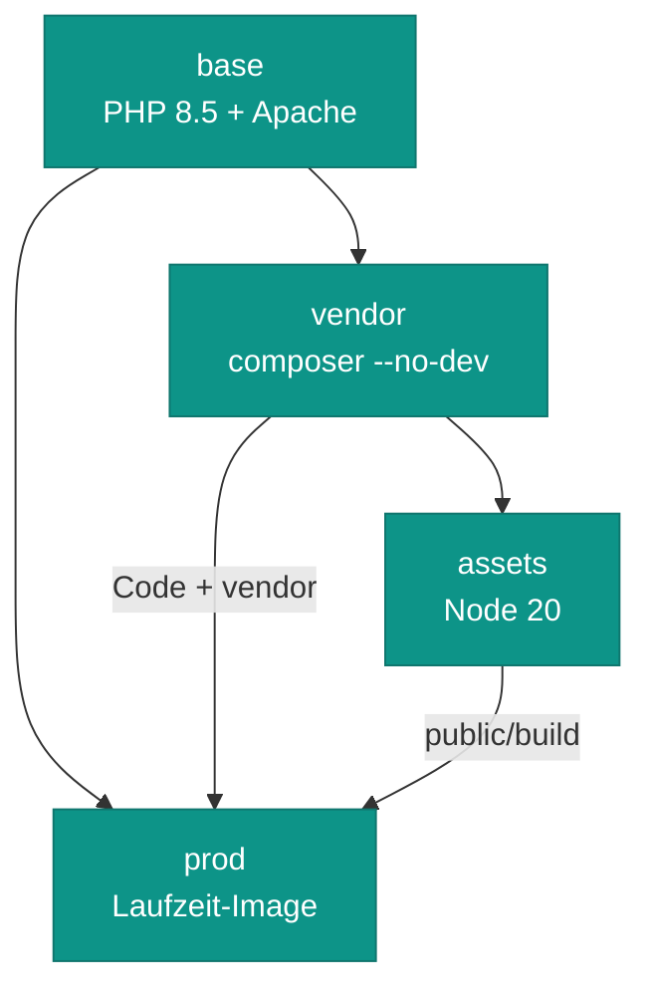

# Betrieb

oralcare deployt über den Komodo-Stack **`oralcare`** auf abyss. Komodo klont das Repo und ruft
`docker compose -p oralcare -f deploy/compose.yaml --env-file .env.prod.local …` auf. Stack und Backup-Procedure
sind als Resource Sync im Repo beschrieben:
[deploy/komodo/oralcare.toml](https://github.com/rextuus/oralcare-cms/blob/main/deploy/komodo/oralcare.toml).
Hintergründe zum Umzug und zur Herkunft der Secrets:
[deploy/UMZUG.md](https://github.com/rextuus/oralcare-cms/blob/main/deploy/UMZUG.md).

## Deploy

<div class="hl-steps" markdown>

1. **Push**
   Änderungen nach `main` pushen. Es gibt keinen Webhook und kein Auto-Deploy, deployt wird bewusst.
2. **Deploy in Komodo**
   Stack `oralcare` → *Deploy*. Komodo holt den Stand per `git pull` und schreibt `.env.prod.local` (Rechte 600)
   aus dem Stack-Environment.
3. **Pre Deploy: prüfen und sichern**
   `deploy/komodo/pre-deploy.sh` bricht ab, wenn noch ein `[[…]]`-Platzhalter in der Env-Datei steht oder das
   DB-Volume `oralcare_database_data` fehlt. Dann sichert es die Datenbank als `pre-deploy_su_myapp_*.sql.gz`
   (die letzten 5 bleiben). Bei einem Fehler ist nichts verändert.
4. **Image bauen**
   `oralcare-cms:prod` wird auf abyss gebaut (siehe unten). Mit Docker-Cache geht das schnell, ohne Cache dauert
   es 7–8 Minuten.
5. **Start mit `--wait`**
   Grün meldet Komodo erst, wenn `php` und `database` *healthy* sind (max. 300 s). Die Seite ist nur beim
   Austausch des php-Containers kurz weg.
6. **Smoke-Test**
   Startseite, eine Unterseite und `/admin` öffnen. Im Quelltext der Startseite muss das Canonical mit
   `https://` beginnen.

</div>

!!! warning "Schema-Änderungen passieren nie automatisch"
    Es gibt keine Doctrine-Migrationen im Deploy. Bringt ein Sulu-Update Schema-Änderungen mit, vorher ansehen und
    bewusst anwenden:
    `sudo docker exec oralcare-php-1 bin/adminconsole doctrine:schema:update --dump-sql`

## Rollback

<div class="hl-steps" markdown>

1. **Commit festnageln**
   Im Stack unter *Commit* den letzten guten Hash eintragen und *Deploy*. Daten in `/srv/oralcare` und im
   DB-Volume bleiben dabei, wie sie sind.
2. **Datenbank zurück, nur falls nötig**
   Nur wenn die neue Version Inhalte oder Schema kaputt gemacht hat: den Dump `pre-deploy_su_myapp_*.sql.gz`
   dieses Deploys einspielen ([Daten → Wiederherstellen](daten.md#wiederherstellen)).
3. **Feld wieder leeren**
   *Commit* danach leeren, sonst bleibt der Stack auf diesem Stand. Ein Resource Sync setzt das Feld ohnehin auf
   den Wert aus `oralcare.toml` zurück (dort leer).

</div>

## Image-Bau



*Multi-Stage-Build aus [deploy/Dockerfile](https://github.com/rextuus/oralcare-cms/blob/main/deploy/Dockerfile).
Code, `vendor` und gebaute Assets stecken fertig im Image, nichts wird in den Container gemountet außer den
Datenordnern. Der Cache für Website und Admin wird schon beim Bauen vorgewärmt.*

- **assets** baut zwei Dinge: das Website-CSS (Webpack Encore, `assets/website`) und den Sulu-Admin
  (`assets/admin`, braucht JavaScript aus `vendor/sulu`).
- **prod** nutzt die Produktions-`php.ini` plus [deploy/php/prod.ini](https://github.com/rextuus/oralcare-cms/blob/main/deploy/php/prod.ini)
  (512 MB RAM für Bildberechnung, Uploads bis 32 MB, OPcache ohne Zeitstempelprüfung).
- **Entrypoint** setzt beim Start den Besitzer leerer Datenordner auf `www-data` und startet Apache.

## Dienste und Zeitpläne

| Dienst | Aufgabe | Healthcheck | Läuft |
|---|---|---|---|
| `php` | Apache + mod_php, Sulu Website und Admin, `10.0.0.2:8192` | `curl /admin/` | dauernd |
| `database` | MySQL 8.4, Volume `oralcare_database_data` | `mysqladmin ping` | dauernd |
| `backup` | DB-Dump und Bilder-Snapshot, [deploy/backup.sh](https://github.com/rextuus/oralcare-cms/blob/main/deploy/backup.sh) | – | nur auf Abruf (`replicas: 0`) |

| Zeitplan | Was | Wo |
|---|---|---|
| täglich 02:30 (Europe/Berlin) | Procedure `oralcare-backup` → `RunStackService backup` | Komodo, Alarm bei Fehler |
| bei jedem Deploy | `backup pre-deploy` (nur Datenbank) | Komodo Pre Deploy |

Sonst läuft nichts im Hintergrund: Messenger arbeitet synchron, es gibt keinen Scheduler und keinen Cron.
`app:analytics:cleanup` ist ein Befehl für Hand und fragt vor dem Löschen nach.

## Variablen

Gesetzt im Stack-Environment in `oralcare.toml`. Werte mit `[[…]]` sind Komodo-Variablen mit Häkchen „Secret“
(*Settings → Variables*).

| Name | Zweck | Secret |
|---|---|---|
| `ORALCARE_APP_SECRET` | Symfony `APP_SECRET`: Sitzungen, vertrauenswürdige 2FA-Geräte | ja |
| `ORALCARE_DATABASE_URL` | Verbindung der App zur Datenbank (Host `database`) | ja |
| `ORALCARE_DB_ROOT_PASSWORD` | MySQL-Root; nutzen auch Healthcheck und Backup. Muss zum bestehenden Volume passen | ja |
| `ORALCARE_SENTRY_DSN` | Fehlermeldungen an Sentry, leer = aus | ja |
| `ORALCARE_MAILER_DSN` | `null://null`: Mailversand ist bewusst abgeschaltet | nein |
| `ORALCARE_BIND` | Port im WireGuard-Netz, `10.0.0.2:8192` | nein |
| `REVERSE_PROXY_IPS` | wird zu `TRUSTED_PROXIES`, die IP des VPS-Caddy | nein |
| `ORALCARE_DATA_DIR` | Datenordner auf dem Host, `/srv/oralcare` | nein |
| `ORALCARE_BACKUP_DIR` | Ziel der Sicherungen, `/srv/backups/oralcare` | nein |
| `ORALCARE_DB_VOLUME` | Name des DB-Volumes; nicht gesetzt, Standard `oralcare_database_data` | nein |

!!! info "Was nicht im Stack steht, kommt aus `.env`"
    mod_php sieht nur die Variablen, die [deploy/apache/oralcare-env.conf](https://github.com/rextuus/oralcare-cms/blob/main/deploy/apache/oralcare-env.conf)
    per `PassEnv` durchreicht (`APP_ENV`, `APP_DEBUG`, `APP_SECRET`, `DATABASE_URL`, `MAILER_DSN`, `SENTRY_DSN`,
    `TRUSTED_PROXIES`). Alles andere, z. B. `SEAL_DSN` (Suchindex), `SULU_ADMIN_EMAIL` und `LOCK_DSN`, liest
    Symfony aus der eingecheckten `.env` im Image.

## Nützliche Befehle

=== "abyss"

    ```bash
    # Zustand und Logs (alle docker-Befehle mit sudo)
    sudo docker ps --format '{{.Names}}\t{{.Status}}' | grep oralcare
    sudo docker logs -f oralcare-php-1
    sudo docker exec oralcare-php-1 php -v

    # Sulu-Konsole: Admin-Kontext bzw. Website-Kontext
    sudo docker exec oralcare-php-1 bin/adminconsole cache:clear
    sudo docker exec oralcare-php-1 bin/websiteconsole cache:clear

    # Backup von Hand (sonst: Procedure in Komodo starten)
    cd /etc/komodo/stacks/oralcare
    sudo docker compose -p oralcare -f deploy/compose.yaml --env-file .env.prod.local run --rm --no-deps backup
    ```

=== "Von außen"

    ```bash
    for p in / /kontakt /leistungen /impressum /datenschutz; do
      curl -s -o /dev/null -w "%{http_code} $p\n" https://zahnarztpraxis-kaldauen.de$p; done
    curl -s https://zahnarztpraxis-kaldauen.de/ | grep -oE 'rel="canonical"[^>]*'   # https:// erwartet
    ```

=== "Lokal"

    ```bash
    # Altes Entwicklungs-Setup im Repo-Root (compose.yaml + Dockerfile, Port 8080, Projektordner gemountet)
    docker compose up -d
    npm run watch   # Website-CSS neu bauen
    ```
