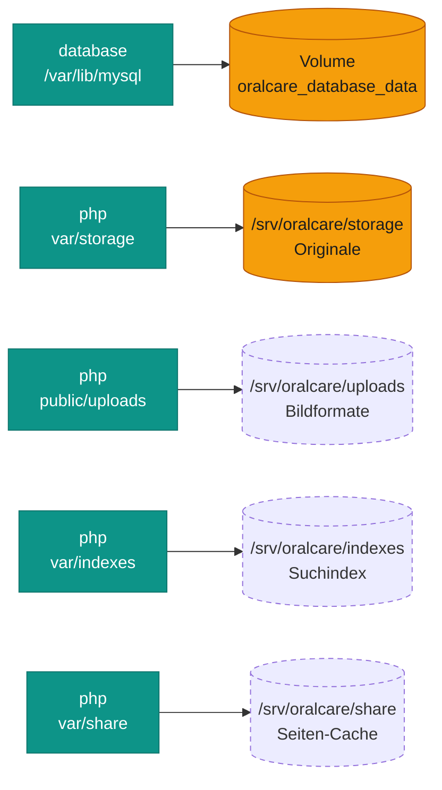
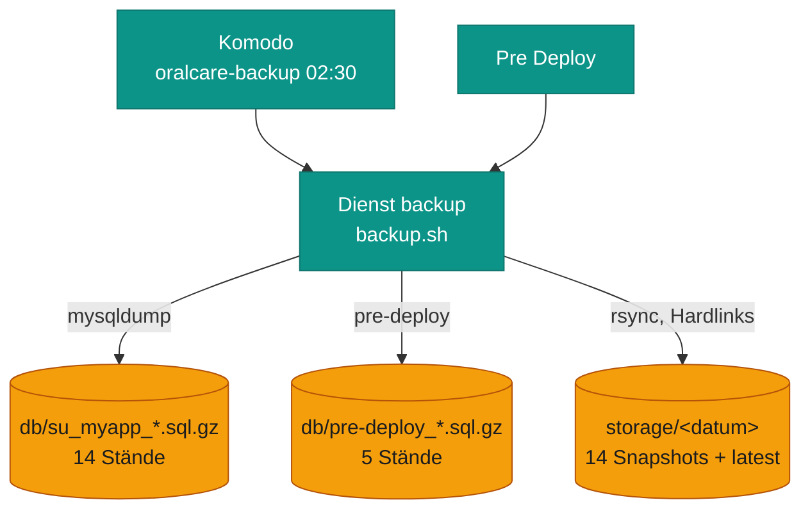

# Daten

Alle Daten liegen auf abyss außerhalb des Images: die Datenbank in einem Docker-Volume, alles Dateibasierte in
vier Ordnern unter `/srv/oralcare`. Das Image selbst lässt sich jederzeit aus Git neu bauen.

## Was wo liegt

*Gefüllt = unersetzlich und gesichert. Gestrichelt = lässt sich neu erzeugen und wird nicht gesichert.*

| Ort | Inhalt | Ersetzbar? | Gesichert |
|---|---|---|---|
| Volume `oralcare_database_data` | Datenbank `su_myapp`: Seiten, Snippets, Benutzer, Medien-Metadaten, Analytics | nein | ja, nachts + vor jedem Deploy |
| `/srv/oralcare/storage` | Hochgeladene Originalbilder (Flysystem `default.storage`) | nein | ja, nachts |
| `/srv/oralcare/uploads` | Berechnete Bildformate (Thumbnails, WebP …) | ja, Sulu rechnet fehlende beim ersten Abruf neu | nein |
| `/srv/oralcare/indexes` | Suchindex (Loupe) | ja, per Reindex | nein |
| `/srv/oralcare/share` | Seiten-Cache und Cache-Pools | ja, startet leer | nein |

!!! warning "Das DB-Volume ist `external`"
    `deploy/compose.yaml` legt das Volume nie selbst an, und `pre-deploy.sh` bricht ab, wenn es fehlt. So kann ein
    Tippfehler nicht still eine leere Datenbank erzeugen. `docker compose down` deshalb **nie mit `-v`**.

!!! danger "Personenbezogene Daten"
    Die Datenbank enthält Benutzerkonten der Praxis, Kontaktdaten aus Sulu und die Analytics-Einträge (URL,
    User-Agent, Referer, keine IP). Dumps also nie ins Repo oder auf fremde Rechner legen. Für Dumps und Archive
    gibt es Einträge in `.gitignore` und `.dockerignore`.

## Backup

*Alles landet in `/srv/backups/oralcare` (Rechte 700). Die Bilder-Snapshots nutzen Hardlinks: unveränderte Dateien
belegen keinen zusätzlichen Platz. Von dort holt die homelab-Offsite-Sicherung die Daten außer Haus.*

- **Nachts** sichert das Skript erst die Datenbank, dann einen Snapshot von `/srv/oralcare/storage`.
  Rotiert wird nach Anzahl, nicht nach Alter, weil `rsync -a` alte Änderungsdaten übernimmt.
- **Jeder Fehler** endet mit Exit-Code ≠ 0, und Komodo schickt einen Alarm: Datenbank nicht erreichbar, Dump
  unvollständig (ohne „Dump completed“), Bilderordner leer, rsync-Fehler oder ein zweiter Lauf parallel (`flock`).
- **Testen, ob der Alarm ankommt:** In der Procedure einmal `BACKUP_SELFTEST_FAIL=1` setzen und starten. Der Lauf
  muss fehlschlagen und alarmieren. Danach wieder entfernen.

## Wiederherstellen

Die Befehle sind aus dem Backup-Skript abgeleitet. Ein Dump wurde beim Umzug lokal einmal zurückgespielt
(93 Tabellen, 156 Medien), auf abyss ist dieser Ablauf noch nicht geprobt.

1. **Website anhalten**
   `sudo docker stop oralcare-php-1`. Die Datenbank läuft weiter, es kommen keine neuen Änderungen dazu.
2. **Stand wählen**
   `sudo ls -l /srv/backups/oralcare/db/ /srv/backups/oralcare/storage/`. Zu einem nächtlichen Dump gehört der
   Bilder-Snapshot derselben Nacht.
3. **Datenbank einspielen**
   Der Dump enthält `CREATE DATABASE` und `USE`, er ersetzt `su_myapp` komplett:
   `zcat /srv/backups/oralcare/db/DATEI.sql.gz | sudo docker exec -i oralcare-database-1 sh -c 'exec mysql -uroot -p"$MYSQL_ROOT_PASSWORD"'`
4. **Bilder zurück, falls nötig**
   `sudo rsync -aH --delete /srv/backups/oralcare/storage/DATUM/ /srv/oralcare/storage/`,
   danach `sudo chown -R 33:33 /srv/oralcare/storage` (`www-data` im Image).
5. **Caches leeren**
   `sudo rm -rf /srv/oralcare/share/prod/http_cache`, sonst zeigt der Seiten-Cache noch den alten Stand.
   Findet die Website-Suche Seiten nicht: `sudo docker exec oralcare-php-1 bin/adminconsole cmsig:seal:reindex`.
6. **Starten und prüfen**
   `sudo docker start oralcare-php-1` (oder in Komodo *Deploy*). Startseite mit Bildern, eine Unterseite und den
   Admin-Login prüfen.

??? example "Probelauf auf dem Arbeitsrechner"
    So wurde das Backup am 06.11.2026 geprüft: Dump und Bilder auf den Arbeitsrechner holen, lokal mit dem
    Image starten, Seite und Admin ansehen. Dumps danach wieder löschen, sie enthalten Personendaten.
