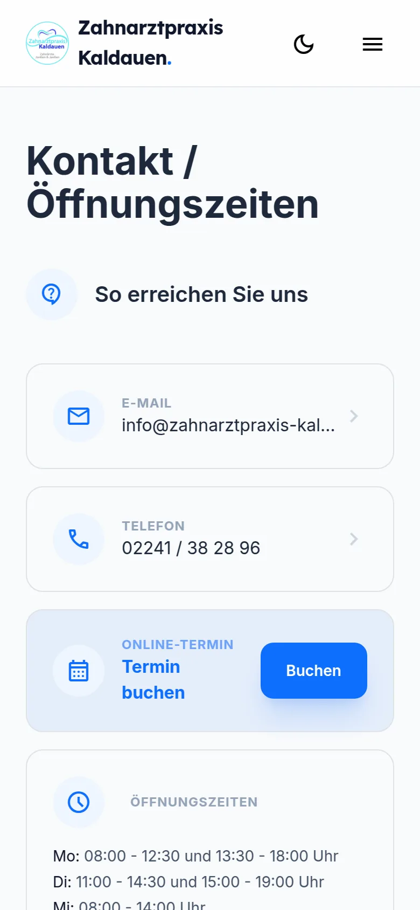
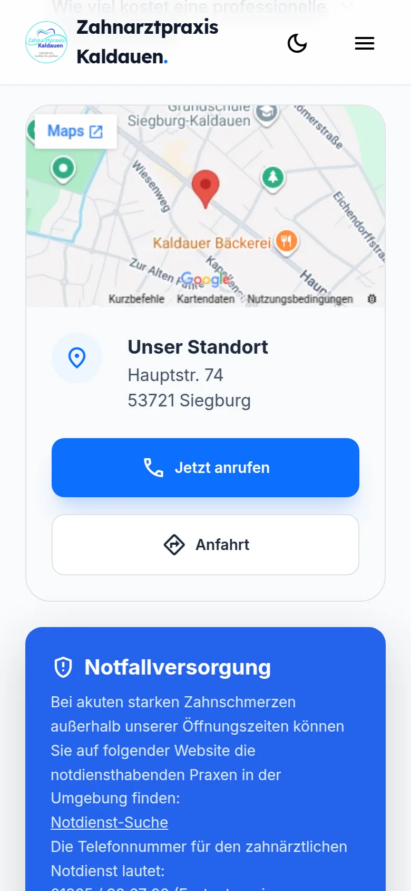
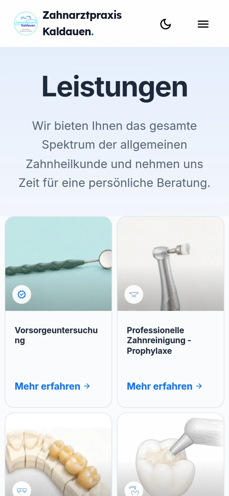
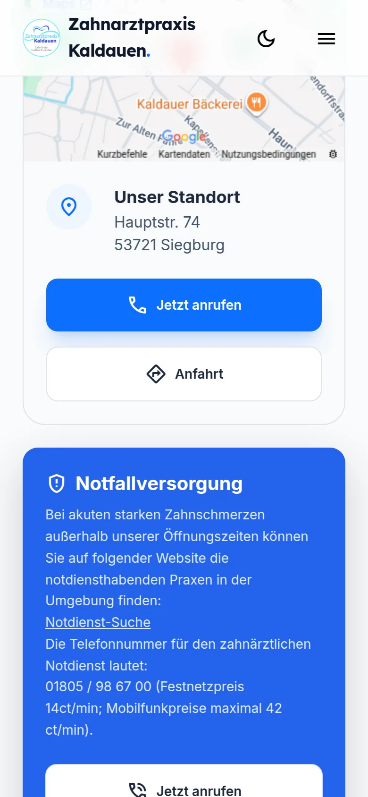
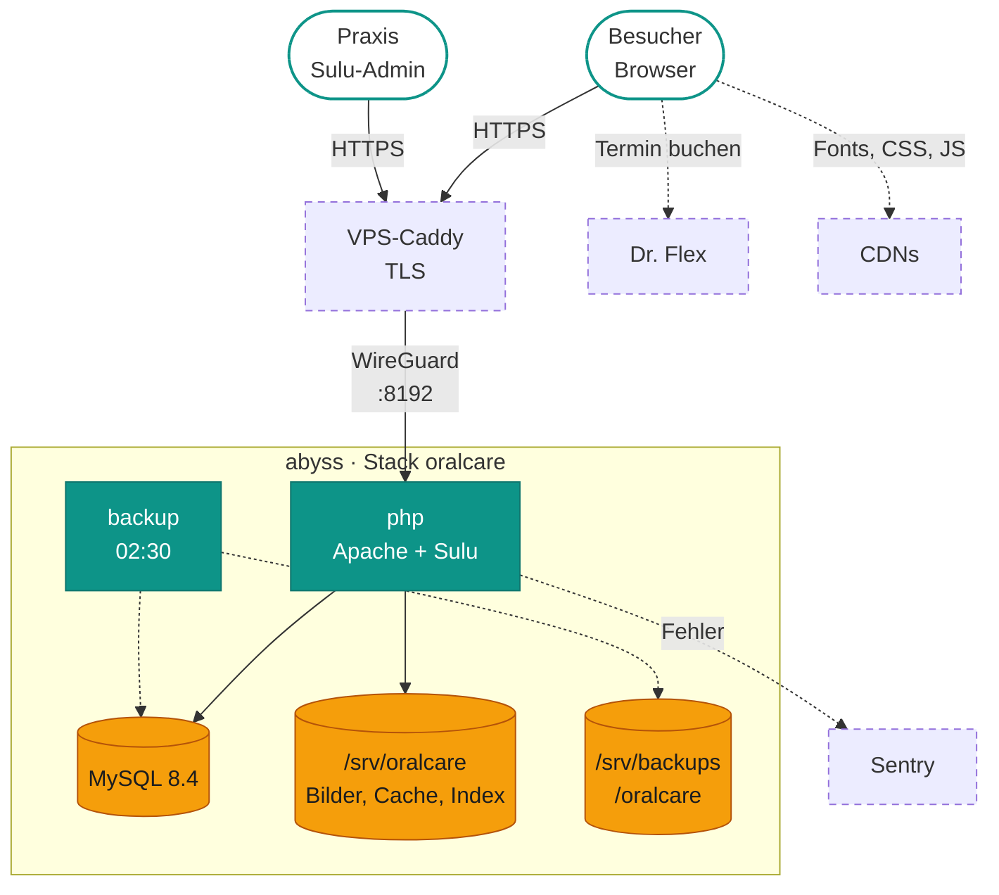

# oralcare – Überblick

<em>Termin buchen</em>, Weg finden, Team kennenlernen.

Die Website der Zahnarztpraxis in Siegburg-Kaldauen: Termin online buchen, auch per QR-Code vom Flyer, dazu Öffnungszeiten, Anfahrt und Notdienst sofort zur Hand.

<ol>
<li data-title="Termin online buchen" data-icon="calendar" data-badges="Dr. Flex|per QR-Code|Team-Kalender">

Ein Klick auf „Termin buchen“ öffnet das Buchungsfenster direkt auf der Seite. Wer den QR-Code auf dem Flyer scannt, landet sofort darin.

</li>
<li data-title="Anfahrt & Öffnungszeiten" data-icon="map" data-badges="Google Maps|Route planen|Anruf per Tipp">

Adresse mit Karte, Wegbeschreibung per Knopf und Anrufen mit einem Tippen. Die Öffnungszeiten stehen überall gleich und aktuell.

</li>
<li data-title="Team kennenlernen" data-icon="users" data-badges="4 Bereiche|Schwerpunkte|Kontakt direkt">

Wer behandelt mich? Das Team lässt sich nach Zahnärzten, Empfang, Assistenz und Prophylaxe filtern, jede Person hat eine eigene Seite.

</li>
<li data-title="Leistungen & Ratgeber" data-icon="star" data-badges="Detailseiten|Ratgeber|FAQ">

Jede Behandlung ist auf einer eigenen Seite erklärt, dazu Ratgeber-Artikel und Antworten auf häufige Fragen.

</li>
<li data-title="Notdienst & Aktuelles" data-icon="bell" data-badges="Notdienst-Info|Urlaubshinweis|3 Farben">

Bei Zahnschmerzen außerhalb der Sprechzeiten steht gleich da, wer hilft. Praxisurlaub und Neuigkeiten erscheinen gut sichtbar auf der Startseite.

</li>
<li data-title="Praxis pflegt selbst" data-icon="edit" data-badges="Entwurf & live|Rollenrechte|2. Faktor">

Das Praxisteam ändert Texte, Bilder und Zeiten selbst und stellt sie erst online, wenn alles fertig ist.

</li>
</ol>
<ul class="hl-showcase__tags"><li>Bildergalerie mit Vollbild</li><li>Eigene Handy-Bilder</li><li>Dunkler Modus</li><li>Leistungs-Karussell</li><li>Volltextsuche</li><li>QR-Weiterleitungen</li><li>Besucherstatistik</li><li>Öffnungszeiten je Seite</li><li>Social-Media-Links</li><li>Ohne Anmeldung</li><li>Impressum &amp; Datenschutz</li></ul>

oralcare ist die Website der **Zahnarztpraxis Kaldauen**, gebaut mit dem CMS [Sulu](https://sulu.io/) 3.0 auf
Symfony 7.4. Die Praxis pflegt Seiten, Team, Leistungen, Öffnungszeiten und Bilder selbst im Sulu-Admin. Termine
bucht man über das eingebettete Buchungsfenster von Dr. Flex. Eigener Code gibt es nur wenig: ein kleines
Besucher-Analytics im Admin und eine QR-Code-Weiterleitungsseite. Der Rest sind Sulu-Templates und Twig.

!!! info "Stand"
    Seit November 2026 läuft die Seite als Komodo-Stack **`oralcare`** aus einem fertigen Image. Der alte,
    von Hand gestartete Stack unter `/opt/oralcare-cms` ist nur noch Rückfallebene und wird später gelöscht.

## Architektur

*Ein Container macht alles: Apache mit mod_php liefert Website und Admin aus. Nach außen geht nur Port 8192 im
WireGuard-Netz, HTTPS macht der Caddy auf dem VPS. Der Backup-Dienst läuft nur nachts kurz.*

- **php** (PHP 8.5, Apache, Sulu) ist die ganze Anwendung. Website und Admin unterscheiden sich nur am Pfad:
  alles unter `/admin` ist der Admin-Kontext, der Rest die Website mit vorgeschaltetem Seiten-Cache.
- **database** (MySQL 8.4) hält Inhalte, Benutzer, Medien-Metadaten und die Analytics-Daten.
- **backup** startet nur über die Komodo-Procedure (nachts) oder vor jedem Deploy, siehe [Daten](daten.md).
- **Fremddienste:** Dr. Flex (Termin-Widget, im Browser des Besuchers), Sentry (Fehlermeldungen vom Server) sowie
  Google Fonts, Tailwind-CDN und jsDelivr (Bootstrap, Icons, Lightbox) direkt aus den Templates.

## Kennzahlen

  
<b>2</b>Dauerdienste php, database

  
<b>1</b>Einmal-Dienst backup

  
<b>93</b>Tabellen davon 1 eigene

  
<b>12</b>Seiten-Templates + 1 Artikel

  
<b>6</b>Snippets Adresse, Kopf, Fuß …

  
<b>8</b>eigene Routen Analytics-API im Admin

  
<b>1</b>Konsolen-Befehl app:analytics:cleanup

  
<b>4</b>Komodo-Secrets Präfix ORALCARE_

## Auf einen Blick

-   :material-tooth-outline:{ .lg } **Für wen**

    ---

    Patientinnen und Patienten der Praxis (öffentliche Website, Deutsch und Englisch) und das Praxisteam,
    das die Inhalte selbst pflegt.

-   :material-web:{ .lg } **Was es kann**

    ---

    Siehe Showcase oben. Technisch: Sulu-Seiten und Snippets, Dr.-Flex-Widget, QR-Landingpage und
    ein eigenes Besucher-Analytics im Admin.

-   :material-shield-lock-outline:{ .lg } **Wer was darf**

    ---

    Die Website ist öffentlich, ohne Konten. Den Admin unter `/admin` nutzt nur die Praxis: Login mit Passwort,
    optional zweiter Faktor. Was jemand im Admin sieht, regeln Sulu-Rollen; Analytics ist ein eigenes Recht.

## Weitere Seiten

| Seite | Inhalt |
|---|---|
| [Aufbau](aufbau.md) | Seitenaufruf mit Cache, Admin-Login, QR-Weiterleitung, Inhaltsmodell, Datenmodell |
| [Betrieb](betrieb.md) | Deploy, Rollback, Image-Bau, Dienste, Variablen, nützliche Befehle |
| [Daten](daten.md) | Was wo liegt, Backup, Wiederherstellung |
| [Wenn's hakt](probleme.md) | Symptome → Ursache → Abhilfe |

## Vorhandene Doku im Repo

| Datei | Worum es geht |
|---|---|
| [deploy/UMZUG.md](https://github.com/rextuus/oralcare-cms/blob/main/deploy/UMZUG.md) | Umzug vom manuellen Stack nach Komodo: Prüfungen, Rückfall, Herkunft der Secrets, Altlasten in `/opt` |
| [deploy/compose.yaml](https://github.com/rextuus/oralcare-cms/blob/main/deploy/compose.yaml) | Der Produktions-Stack, mit Kommentaren |
| [deploy/komodo/oralcare.toml](https://github.com/rextuus/oralcare-cms/blob/main/deploy/komodo/oralcare.toml) | Komodo-Stack und Backup-Procedure als Resource Sync |
| [README.md](https://github.com/rextuus/oralcare-cms/blob/main/README.md) | Unverändertes README des Sulu-Skeletons, nichts Projektspezifisches |
