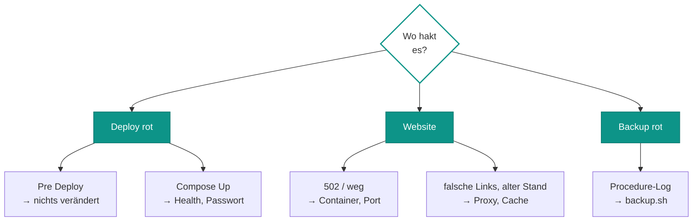

# Wenn's hakt

*Erste Frage: Wo bricht es ab? Das Komodo-Update-Log (Stack → Updates) zeigt jede Stufe einzeln. Im Betrieb hilft
`sudo docker logs -f oralcare-php-1`. Fehler landen außerdem in Sentry, sofern `ORALCARE_SENTRY_DSN` gesetzt ist.*

## Deploy

??? failure "Pre Deploy rot: „In Komodo fehlen diese Variablen/Secrets“"
    **Ursache:** Ein `[[ORALCARE_…]]` im Stack-Environment hat keine passende Komodo-Variable. Komodo lässt den
    Platzhalter dann wörtlich stehen, ohne Fehler zu melden. `pre-deploy.sh` fängt das ab.

    **Abhilfe:** Variable unter *Settings → Variables* anlegen (Schreibweise prüfen, Häkchen „Secret“). Es wurde
    nichts verändert, einfach neu deployen.

??? failure "Pre Deploy rot: „DB-Volume oralcare_database_data fehlt“"
    **Ursache:** Das Volume ist absichtlich `external` und wird nie automatisch angelegt. Fehlt es, wurde es gelöscht
    oder der Name in `ORALCARE_DB_VOLUME` stimmt nicht.

    **Abhilfe:** `sudo docker volume ls | grep oralcare` ansehen. **Kein** leeres Volume anlegen, sondern klären, wo die
    Daten sind. Im Zweifel aus dem Backup wiederherstellen ([Daten](daten.md#wiederherstellen)).

??? failure "Deploy rot nach 300 s: database wird nicht healthy"
    **Ursache:** Meist passt `ORALCARE_DB_ROOT_PASSWORD` nicht zum Volume. MySQL übernimmt das Passwort nur beim
    allerersten Anlegen, danach gilt das alte. Der Healthcheck meldet sich mit dem neuen an und scheitert.

    **Abhilfe:** Secret auf das bisherige Root-Passwort zurücksetzen und neu deployen. Das Passwort ändert man in
    MySQL selbst, erst danach im Secret.

??? failure "Deploy rot: php wird nicht healthy"
    **Ursache:** Der Healthcheck ruft `http://localhost/admin/` im Container ab. Scheitert das, startet Sulu nicht
    sauber: falsche `ORALCARE_DATABASE_URL`, fehlende Rechte auf `/srv/oralcare` oder ein Fehler im neuen Code.

    **Abhilfe:** `sudo docker logs oralcare-php-1` lesen. Sonderzeichen im DB-Passwort müssen in der URL kodiert sein
    (`@` → `%40`, `/` → `%2F`, `:` → `%3A`, `#` → `%23`). Sonst zurückrollen ([Betrieb](betrieb.md#rollback)).

## Website

??? failure "502 vom VPS"
    **Ursache:** Caddy erreicht `10.0.0.2:8192` nicht: Container `oralcare-php-1` läuft nicht, oder WireGuard
    zwischen VPS und abyss ist weg.

    **Abhilfe:** Auf abyss `sudo docker ps | grep oralcare` und
    `curl -s -o /dev/null -w '%{http_code}\n' http://10.0.0.2:8192/admin/` (200 oder 302 erwartet). Antwortet der
    Container, liegt es am Tunnel oder am Caddy, das steht auf den allgemeinen homelab-Seiten.

??? failure "Canonical- und hreflang-Links beginnen mit http://"
    **Ursache:** Sulu sieht die Anfrage als `http`, weil es dem Absender nicht vertraut. `TRUSTED_PROXIES` muss die
    Adresse enthalten, von der die Anfragen im Container ankommen (`10.0.0.1`). Der Seiten-Cache hält die falschen
    Links danach bis zu sieben Tage fest.

    **Abhilfe:** Absender prüfen:
    `sudo docker logs oralcare-php-1 2>&1 | grep -E '"GET / ' | tail -2 | cut -d' ' -f1`. Steht dort z. B.
    `172.x.0.1` statt `10.0.0.1`, schiebt sich Docker-NAT dazwischen. Dann in `oralcare.toml`
    `REVERSE_PROXY_IPS = 10.0.0.1,172.x.0.1` setzen, pushen, Sync, Deploy. Danach den Cache leeren:
    `sudo rm -rf /srv/oralcare/share/prod/http_cache`.

??? failure "Website verbindet sich mit der falschen Datenbank (127.0.0.1:3307)"
    **Ursache:** mod_php reicht Umgebungsvariablen nur durch, wenn sie in `deploy/apache/oralcare-env.conf` per
    `PassEnv` stehen. Fehlt eine, nimmt Symfony den Wert aus der eingecheckten `.env`, und die zeigt auf die lokale
    Entwicklungs-Datenbank.

    **Abhilfe:** Neue Variablen immer an drei Stellen eintragen: `oralcare.toml` (Environment),
    `deploy/compose.yaml` (`environment:` von `php`) und `PassEnv`.

??? failure "Änderung im Admin erscheint nicht auf der Website"
    **Ursache:** Nur gespeichert, nicht veröffentlicht. Oder der Seiten-Cache liefert noch den alten Stand, etwa bei
    Snippets, die auf vielen Seiten stecken.

    **Abhilfe:** Im Admin „Veröffentlichen“ prüfen. Sonst Website-Cache leeren:
    `sudo docker exec oralcare-php-1 bin/websiteconsole cache:clear` oder
    `sudo rm -rf /srv/oralcare/share/prod/http_cache`.

??? failure "Bilder fehlen oder neue Formate werden nicht erzeugt"
    **Ursache:** `www-data` (UID/GID 33) darf nicht in `/srv/oralcare/storage` oder `/srv/oralcare/uploads`
    schreiben, etwa nach einem `rsync` als root.

    **Abhilfe:** `sudo chown -R 33:33 /srv/oralcare`. Fehlende Formate rechnet Sulu beim nächsten Abruf selbst
    nach. Fehlt das Original in `storage`, hilft nur der Bilder-Snapshot aus dem Backup.

??? failure "Upload großer Bilder bricht ab"
    **Ursache:** PHP nimmt höchstens 32 MB pro Upload an (`upload_max_filesize`, `post_max_size` in
    `deploy/php/prod.ini`); die Bildberechnung hat 512 MB Speicher.

    **Abhilfe:** Bild vorher verkleinern. Grenzen nur anheben, wenn es wirklich nötig ist, dann neu deployen.

??? failure "Alle Admins sind abgemeldet, 2FA-Geräte unbekannt"
    **Ursache:** `ORALCARE_APP_SECRET` hat sich geändert. Sitzungen und vertrauenswürdige Geräte hängen daran.

    **Abhilfe:** War es Absicht (Rotation), einfach neu anmelden. Sonst den bisherigen Wert wieder eintragen und
    neu deployen.

## Backup

??? failure "Procedure oralcare-backup rot"
    **Ursache:** Das Log der Procedure nennt den Grund aus `backup.sh`:

    - „Datenbank database nicht erreichbar“: Stack läuft nicht. Die Procedure startet die Datenbank absichtlich
      nicht mit (`no_deps`).
    - „DB-Dump unvollständig“ oder „mysqldump fehlgeschlagen“: Platte voll oder DB-Fehler, `df -h /srv` prüfen.
    - „/data/storage ist leer – Mount prüfen“: `/srv/oralcare/storage` ist leer oder `ORALCARE_DATA_DIR` falsch.
    - „Backup läuft bereits“: ein zweiter Lauf parallel, z. B. von Hand gestartet.

    **Abhilfe:** Ursache beheben und die Procedure in Komodo von Hand starten. Danach
    `sudo ls -la /srv/backups/oralcare/db/ /srv/backups/oralcare/storage/` ansehen.
